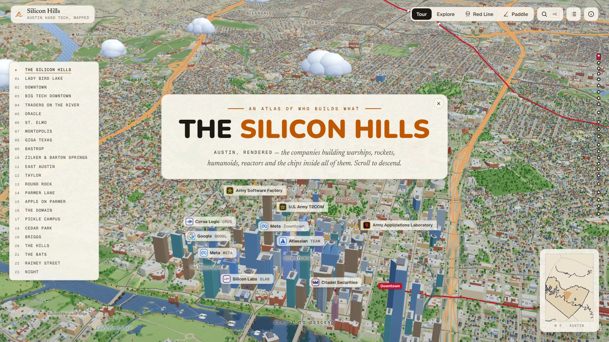

# Silicon Hills

**A living 3D atlas of Austin's hard tech**, made in the spirit of the Levels.fyi atlases. Fly a
model of Central Texas and meet the companies building warships, rockets, humanoid robots,
reactors and chips around Austin, and the big tech and trading firms beside them.



- **Live:** <https://abhidotbandi.vercel.app/atlas>
- **Author:** Abhi Bandi (built with Claude Code)
- **License:** MIT for the code. The map data and logos keep their own terms; see
  [NOTICE.md](NOTICE.md).

## What's in it

- **The city in 3D.** Terrain, water and every building Overture maps, at their real heights:
  about 77,000 always loaded, and over 800,000 more in detail tiles that stream in around the
  camera. Roads have traffic, and parks have trees and people.
  The light runs from dawn to night: the moonlight towers glow and the bats leave the Congress
  Avenue Bridge at dusk.
- **71 companies on 85 sites.** They span defense and space, chips, energy, robotics, big tech
  and finance. Each one stands on its own building. Its card has what it builds, its status and
  facts, and links to every source.
- **Signature models.** Giga Texas, Samsung Taylor, the NXP fabs, SkyWater Fab 25, Firefly's
  Rocket Ranch, the Boring Company, the UT Tower and campus, the Capitol, Austin-Bergstrom's
  terminal and more.
- **Ways to see it.**
  - A scroll-driven tour in 24 chapters, from downtown out to Taylor, Bastrop and Briggs.
  - Free exploration, with search, a sortable table and per-company cards.
  - A ride on the Red Line commuter train, and a paddle down Lady Bird Lake.
  - A locator map in the corner shows where you are.
- **Built to run anywhere.** Phones and low-core machines get lighter data and meshes, and the
  frame rate governs quality on the fly. Reduced-motion and keyboard users are covered too.

## Run it

Requires Node 20.9 or newer.

```bash
npm ci
npm run dev        # http://localhost:3000 (redirects to /atlas)
npm run build && npm start
```

Deep links also work:

- `/atlas?c=<site-id>` opens a company's site.
- `/atlas?p=<place-id>` opens a place.
- `/atlas?at=lat,lon,dist_km,tilt,bearing&tod=0..1` opens a camera position at a time of day.
- `/atlas?ride=1` starts the train ride, and `/atlas?paddle=1` the paddle.

All map data is prebuilt and committed under `public/atlas/` (about 35 MB), so the app needs no
API keys or services.

## How it's put together

| Where | What |
|---|---|
| `src/app/atlas/` | The route, the fonts, and an early script that starts the map downloads while the page is still parsing |
| `src/components/atlas/AtlasApp.tsx` | The shell: loading, the tour's scroll timeline, the modes (tour, explore, ride, paddle) and deep links |
| `src/components/atlas/scene/` | The React Three Fiber scene. `AtlasCanvas.tsx` mounts it in stages: the regional map first, central Austin's detail when it arrives, then the extras. Each file is one layer: `Terrain`, `Water`, `Buildings`, `DetailTiles`, `Trees`, `Landmarks`, `SiteModels`, `Airport`, `CityLife`, `ParkLife`, `PeasePark`, `RedLine`, `Paddle`, `Bats`, `Sky`, `Clouds` and others |
| `src/components/atlas/ui/` | Header, story cards, chapter list and rail, explore panel, company and place cards, search, table, labels, locator, loader |
| `src/lib/atlas/prep/` | A web worker that decodes the binary files and builds the meshes' arrays off the main thread |
| `src/lib/atlas/detail/` | The detail tiles' worker: streets, parking, pools and buildings around the camera |
| `src/lib/atlas/siteModels/` | Company site models: a kit of parts, archetypes (office, glass, lab, factory, fab) and the signature sites |
| `src/lib/atlas/store.ts` | App state (zustand), plus `runtime`, the per-frame values the scene and UI share without React |
| `src/data/atlas/` | The content: `companies.json`, `tour.ts` (the chapters), `places.ts`, `domains.ts`, and the traced terminal and locator data |
| `scripts/atlas/` | The Python data pipeline (see below) |
| `docs/atlas/PLAN.md` | The design plan and a log of every change, with the reasoning and sources behind it |

## Changing the content

- **A company or site.** Edit `src/data/atlas/companies.json`. Each site has:
  - a `lat`/`lon` on its building, and a `radius` in km;
  - optionally `shares`, the site id of a co-tenant whose building it is in;
  - optionally `buildings`, a `[lat, lon]` point inside each of its buildings, for a campus whose
    radius would take in other businesses.

  A private company's status can carry a `stage` (for example "Privately held"); without one,
  its card says "Venture-backed".

  Then run `python scripts/atlas/build_buildings.py` and `python scripts/atlas/build_tiles.py` to
  re-tag the footprints. Add a logo in `scripts/atlas/build_logos.py`, and a model archetype in
  `src/lib/atlas/siteModels/archetypes.ts`.
- **The tour.** Edit `src/data/atlas/tour.ts`. Each chapter has its sites, camera view, time of
  day and text.
- **A building the map is missing.** Trace it in `scripts/atlas/traced_buildings.py`.

## Rebuilding the data

The pipeline bakes everything in `public/atlas/` from open data. The sources are the Overture
Maps release named in `scripts/atlas/config.py` (read straight from its public S3 bucket),
Terrain Tiles on AWS and USGS imagery.

```bash
python -m venv .venv && . .venv/bin/activate
pip install -r scripts/atlas/requirements.txt
python scripts/atlas/build_all.py      # downloads into scripts/atlas/.cache (git-ignored), then builds
```

`scripts/atlas/README.md` lists each output, the script that builds it and its sources. Each step
can be run on its own. The first run caches about 350 MB of source data, and the detail tiles take
a few minutes to build.

## Open questions

The full list is in `docs/atlas/PLAN.md` (sections 2.29 to 2.32).

- **Firefly.** Its HQ (2203 Scottsdale Dr) and the Hive (5900 183A Toll Rd) are sourced. Its May
  2026 expansion added "two new buildings adjacent to the spacecraft facility", but no source
  says which buildings those are, so they aren't tagged yet.
- **AMD.** No source maps its building numbers to footprints. The atlas tags the four buildings
  inside the Lone Star campus loop, and one of them also holds SolarWinds.
- **New buildings.** Overture lags new construction, so new buildings may be missing. Check sites
  against current imagery when you update them.
